  

 

 

  

 

## 🧰 &nbsp;Stack

  

 

  

 

## 🎯 &nbsp;Focus

Senior Infrastructure/SRE engineer designing and operating platform-level systems — multi-cluster Kubernetes, org-wide CI/CD, cost governance, and compliance-grade security — for engineering orgs, not single apps.

 

Currently building out a self-service internal platform on top of a multi-cluster Kubernetes fleet, and driving cost + compliance governance across a multi-account AWS Organization.

 

## 🏛️ &nbsp;Platform & architecture initiatives

Systems built for organizational scale — multiple teams, multiple environments, real business constraints. Each one written as Problem → Architecture → Business impact.

 

<table>
<tr>
<td width="50%" valign="top">

#### 🌐 &nbsp;Multi-Cluster Kubernetes Platform
Fleet management across prod, staging & DR

*Problem* — 15+ microservices deployed inconsistently across environments, no shared golden path, each team reinventing manifests 
*Architecture* — 3-cluster fleet (prod / staging / DR across regions) managed via ArgoCD ApplicationSets, shared Helm library charts, centralized RBAC + OPA/Gatekeeper policy enforcement, Cilium for cross-cluster networking 
*Business impact* — cut new-service provisioning from days to under an hour; policy-as-code eliminated an entire class of misconfiguration incidents across teams

`ArgoCD` `OPA/Gatekeeper` `Cilium` `Helm`

</td>
<td width="50%" valign="top">

#### 💵 &nbsp;Org-Wide Cost Governance (FinOps)
Multi-account AWS Organization, $50K+/mo spend

*Problem* — no cost visibility across 10+ AWS accounts, no accountability per team, spend growing faster than usage 
*Architecture* — AWS Organizations + Control Tower guardrails, Cost & Usage Reports into Athena/QuickSight, per-team showback dashboards, automated Savings Plan/RI purchase recommendations, budget alerts tied to Slack 
*Business impact* — ~22% reduction in monthly cloud spend org-wide, full cost attribution per team enabling accurate project P&L

`AWS Organizations` `Athena` `Control Tower`

</td>
</tr>
<tr>
<td width="50%" valign="top">

#### 🔁 &nbsp;Monolith → Microservices Migration
Zero-downtime cutover of a live production system

*Problem* — legacy monolith blocking independent team releases, single point of failure for the whole platform 
*Architecture* — strangler-fig pattern: new services stood up behind an API gateway, traffic shifted incrementally via weighted routing, dual-write + backfill for data consistency, rollback plan rehearsed before each cutover phase 
*Business impact* — migrated a live revenue-generating system with zero customer-facing downtime; independent team deploys went from weekly-coordinated releases to on-demand

`API Gateway` `Strangler Fig` `Dual-Write`

</td>
<td width="50%" valign="top">

#### 🛡️ &nbsp;Compliance-Grade Infrastructure
Audit-ready hardening (SOC 2 / PCI-DSS style controls)

*Problem* — infra couldn't pass a compliance audit: no encryption enforcement, no access reviews, no tamper-evident logs 
*Architecture* — encryption-at-rest/in-transit enforced via SCPs, quarterly IAM access reviews automated with a Lambda, immutable CloudTrail → S3 Object Lock audit trail, compliance-as-code checks (Conftest/OPA) gating every CI pipeline 
*Business impact* — passed external audit readiness review with zero critical findings; compliance checks now block non-compliant infra before it ships

`SCP` `CloudTrail` `Conftest`

</td>
</tr>
<tr>
<td width="50%" valign="top">

#### 🚨 &nbsp;Incident Command & SLO Program
Formal on-call, postmortems & error-budget enforcement

*Problem* — incidents handled ad hoc, no on-call rotation, repeat outages from the same unaddressed root causes 
*Architecture* — SLO/error-budget framework per service, PagerDuty-based on-call rotation with clear escalation paths, blameless postmortem process with tracked action items, runbook library tied to alerts 
*Business impact* — reduced MTTR org-wide, repeat-incident rate dropped as postmortem action items were enforced through the sprint process

`SLO/Error Budgets` `PagerDuty` `Postmortems`

</td>
<td width="50%" valign="top">

#### 🧭 &nbsp;Internal Developer Platform (Self-Service)
Golden paths for 20+ engineers across product teams

*Problem* — platform team was a bottleneck for every new service, environment, or pipeline request 
*Architecture* — Backstage developer portal + ArgoCD GitOps backend, scaffolded golden-path templates (service + CI + monitoring + alerting in one PR), self-service environment provisioning with guardrails baked in 
*Business impact* — platform-team ticket load dropped sharply as teams self-served; new-service lead time went from multi-day platform-team dependency to same-day, engineer-driven

`Backstage` `ArgoCD` `Golden Paths`

</td>
</tr>
</table>

 

## ⚙️ &nbsp;Infrastructure in production

Systems I've designed, deployed, and currently operate. Each is written as Context → Design decisions → Operations, because the trade-offs matter more than the tool list.

 

<table>
<tr>
<td width="50%" valign="top">

#### 🏦 &nbsp;LedgerLine: Fintech Workload on Self-Managed Kubernetes
kubeadm cluster · stateful workloads · alert-pipeline validation

*Context*: a Java banking backend with a React frontend and PostgreSQL, running on a cluster I bootstrapped and operate myself with kubeadm on EC2, without EKS 
*Design decisions*: workload isolation through node pinning (stateful DB tier, app tier, and a dedicated monitoring node, so observability survives an app-tier failure); Postgres as a StatefulSet behind a headless Service with credentials in Secrets; Calico CNI; NGINX Ingress on hostNetwork serving `bank.` and `api.bank.` domains, with CORS enforced at the edge 
*Operations*: kube-prometheus-stack via Helm with custom PrometheusRules (OOMKilled, fast CrashLoop) and Alertmanager routing that sends noise to a null receiver and actionable alerts to the on-call channel. I ran deliberate failure injection (load-driven OOM and crash loops) to prove the detect → alert path end to end before trusting it 
*Access*: the API server is reached only through an SSH tunnel, with no public 6443 exposure

`kubeadm` `Calico` `StatefulSet` `NGINX Ingress` `kube-prometheus-stack`

</td>
<td width="50%" valign="top">

#### 🎟️ &nbsp;TicketFlow: Live Booking Platform & Decomposition Strategy
Production FastAPI/PostgreSQL system · evidence-driven architecture

*Context*: a ticket-booking platform serving live traffic, covering events, seat inventory, bookings, cancellations, payments and notifications, with 139+ commits of continuous delivery 
*Design decisions*: the booking path runs as a single ACID transaction (user/event validation, seat locking, ticket, add-ons and payment) so the system can never oversell a seat. Schema evolves through Alembic migrations, and auth uses JWT with bcrypt 
*Architecture stance*: I chose a modular monolith over premature microservices. Service extraction (auth first, then notifications) and Kafka are gated on load-test and failure-test evidence, and a transactional outbox will be in place before any broker, so no event is lost during the split 
*Operations*: containerised and deployed to a VM, with load-test tooling kept in the repo as part of the release process

`FastAPI` `PostgreSQL` `Alembic` `Outbox Pattern` `Docker`

</td>
</tr>
<tr>
<td width="50%" valign="top">

#### 🧩 &nbsp;BookVault: Service Mesh & GitOps on K3s
3-node cluster · Linkerd · ArgoCD · autoscaling

*Context*: a Django/MySQL application on a self-operated 3-node K3s cluster, where I own scheduling, networking, TLS and scaling end to end 
*Design decisions*: Linkerd mTLS mesh for golden-signal visibility. Because the mesh's sidecar distorted pod-level CPU metrics, I moved HPA to `ContainerResource` metrics, a conflict that only shows up when you run a mesh and autoscaling together. Delivery is Jenkins CI → ArgoCD GitOps, and TLS is Traefik + cert-manager 
*Hardening*: least-privilege RBAC, default-deny NetworkPolicy, node affinity, taints/tolerations, init containers for dependency ordering, and Redis caching to cut DB load 
*Operations*: Prometheus + Grafana + Alertmanager, with alerts routed to a chat channel

`K3s` `Linkerd` `ArgoCD` `HPA/VPA` `cert-manager`

</td>
<td width="50%" valign="top">

#### ⚙️ &nbsp;Electronix: Distributed CI/CD & 3-Tier AWS Architecture
Jenkins controller/agent · S3/CloudFront · EC2 · RDS

*Context*: a full-stack e-commerce platform with payments (Razorpay), deployed on a decoupled 3-tier architecture: S3 + CloudFront frontend, Dockerised backend behind Nginx on EC2, and RDS MySQL 
*Design decisions*: builds run on a dedicated SSH-attached Jenkins agent, never on the controller; credentials come from IAM roles with zero static keys; the S3 origin stays private behind CloudFront OAC; the declarative pipeline handles build → S3 sync → CloudFront invalidation 
*Data migration*: led a MongoDB → MySQL/Sequelize re-platform across 5 models with junction tables and versioned migrations. This was a relational schema redesign, not a lift-and-shift. Sessions are persisted in the DB so the backend tier stays stateless 
*Incidents resolved*: a JDK 17/21 toolchain mismatch on the agent, and an ES-module env-loading race at startup

`Jenkins` `CloudFront OAC` `RDS MySQL` `Sequelize` `Docker`

</td>
</tr>
<tr>
<td width="50%" valign="top">

#### 🔐 &nbsp;SimpleBank: Zero-Standing-Access Delivery
Keyless CI/CD · no SSH · no stored cloud credentials

*Context*: a Flask/MySQL service across a tagged EC2 fleet, where the design goal was to remove standing access entirely, not just to automate deploys 
*Design decisions*: GitHub Actions assumes a scoped IAM role through OIDC federation, so no AWS keys exist anywhere. Deploys run through SSM Session Manager with port 22 closed fleet-wide, and Default Host Management Configuration (DHMC) brings instances under SSM. Secrets come from SSM Parameter Store at runtime, and deploy scripts are distributed through S3 
*Release model*: immutable, tagged images in ECR, with Docker Compose pinned by `IMAGE_TAG` so any previous build can be rolled back to

`OIDC` `SSM Session Manager` `Parameter Store` `ECR`

</td>
<td width="50%" valign="top">

#### 🎯 &nbsp;IQuiz Hub: Containerised Platform on ECS Fargate
Serverless containers · production incident response

*Context*: a React/Node/MongoDB assessment platform with Google OAuth and a proctored coding-exam module, running on ECS Fargate in ap-south-1 
*Incident*: deployments were silently rolled back by the ECS deployment circuit breaker. I traced the root cause to a container/Nginx port mismatch (80 vs 3000) that failed health checks only under real deploy conditions, fixed it, and hardened the pipeline 
*Delivery*: GitHub Actions → versioned images → rolling ECS deploys 
*Product integrity*: Monaco-based exam environment with anti-cheat controls and a server-trusted auto-submit timer, plus cascade deletes to keep quiz and activity records consistent

`ECS Fargate` `Circuit Breaker` `GitHub Actions` `MongoDB`

</td>
</tr>
</table>

📂 &nbsp;More projects: serverless publishing platform, host intrusion monitoring, IaC deployment

 

🌐 &nbsp;**DevOps World**: a fully serverless publishing platform (`blog.devilhai.info`) with no servers to patch. Static frontend on S3 + CloudFront (OAC) + Route 53 + ACM; Cognito for auth; an event-driven subscriber flow through API Gateway → Lambda → SES; DynamoDB for post metadata; and WAF rate limiting on the public subscription endpoint to block abuse.

🚨 &nbsp;**SSH Intrusion Monitor**: host-level detection running as a `systemd` service. It streams `/var/log/auth.log` in real time, geolocates suspicious source IPs and raises email alerts, and a scheduled shell-history audit digest adds an after-the-fact trail of operator activity.

☁️ &nbsp;**TaskMaster**: a Flask/MongoDB Atlas service with all infrastructure defined in Terraform and shipped as a versioned Docker image, so environments are reproducible from code.

📖 &nbsp;**Kubernetes Internals Guide**: a 20-section technical reference I wrote while operating the clusters above, covering control-plane internals, scheduling, networking and RBAC. It is now used as training material for engineers.

 

## 📈 &nbsp;GitHub activity

 

 

 

💬 &nbsp;Open to conversations on SRE practice, cloud architecture, or mentoring engineers.
 
<a href="https://www.linkedin.com/in/YOUR-LINKEDIN-HANDLE">LinkedIn</a> · <a href="https://blog.devilhai.info">Blog</a>

